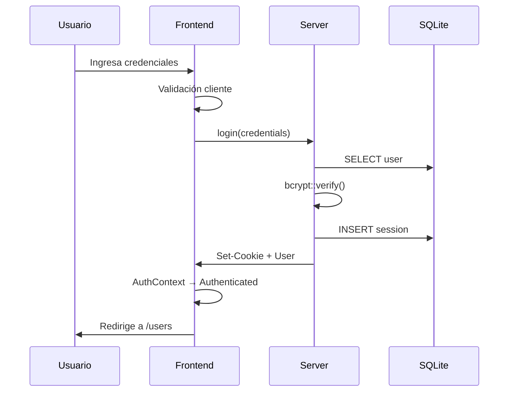

# User Leptos App

Aplicación full-stack con **Leptos 0.9** que demuestra autenticación con cookies, CRUD de usuarios, y arquitectura en capas.

## Características

- **Autenticación** - Login/logout con cookies de sesión y bcrypt
- **CRUD de Usuarios** - Crear, listar, editar y eliminar usuarios
- **SQLite** - Base de datos ligera con sqlx
- **SSR + Hidratación** - Server-side rendering con cliente WASM reactivo
- **UI Moderna** - Tema oscuro con diseño responsive
- **Validaciones** - Cliente y servidor con la crate `validator`

## Arquitectura

```
src/
├── domain/           # Modelos compartidos (isomórfico)
│   ├── user.rs       # User, LoginCredentials, etc.
│   ├── error.rs      # AppError: errores tipados con código HTTP
│   ├── policy.rs     # Reglas de autorización (servidor + UI)
│   ├── state.rs      # AuthState, FormState
│   └── validation.rs # Validaciones
│
├── api/              # Server functions: la frontera de seguridad
│   ├── auth.rs       # login, logout, current_user
│   └── users.rs      # CRUD con guards y políticas
│
├── server/           # Lógica del servidor (#[cfg(feature = "ssr")])
│   ├── app.rs        # build_router (usado por main y por los tests)
│   ├── db.rs         # Pool (inyectado por contexto), schema
│   ├── guards.rs     # require_user / require_admin
│   ├── session.rs    # Sesiones y cookie
│   └── users.rs      # Repositorio de usuarios
│
├── frontend/         # Componentes UI
│   ├── state/        # AuthContext (estado global)
│   ├── auth/         # Página y formulario de login
│   ├── users/        # Tabla, filas, modal CRUD
│   └── layouts/      # Navegación, layout principal
│
├── app.rs            # Router
├── lib.rs            # Exports
└── main.rs           # Entry point
```

## Inicio Rápido

### Prerrequisitos

```bash
# Instalar cargo-leptos
cargo install cargo-leptos

# Añadir target WASM
rustup target add wasm32-unknown-unknown
```

### Ejecutar

```bash
# Modo desarrollo con hot-reload
cargo leptos watch
```

Navegar a **http://127.0.0.1:3000**

### Credenciales por Defecto

| Usuario | Contraseña |
|---------|------------|
| `admin` | `admin123` |

## Comandos Útiles

```bash
# Verificar compilación SSR
cargo check --features ssr

# Verificar compilación cliente (WASM)
cargo check --features hydrate

# Build de producción
cargo leptos build --release

# Ejecutar tests (unitarios + integración de autorización)
cargo test --features ssr
```

## Autorización

Cada server function es un endpoint HTTP público, así que todas empiezan
igual: **autenticación → autorización → validación → repositorio**.

| Endpoint | Anónimo | Usuario | Admin |
|----------|---------|---------|-------|
| `POST /api/list_users` | 401 | ✅ | ✅ |
| `POST /api/create_user` | 401 | 403 | ✅ |
| `POST /api/update_user` | 401 | 403 | ✅ (no puede quitarse su rol) |
| `POST /api/delete_user` | 401 | 403 | ✅ (no puede borrarse a sí mismo) |

```bash
# Sin sesión, el servidor rechaza la petición aunque no pase por la UI
curl -i -X POST http://127.0.0.1:3000/api/delete_user -d id=2
# HTTP/1.1 401 Unauthorized
```

## Dependencias Principales

| Crate | Uso |
|-------|-----|
| `leptos` 0.9 | Framework reactivo full-stack |
| `axum` | Servidor HTTP |
| `sqlx` | Conexión SQLite asíncrona |
| `bcrypt` | Hash de contraseñas |
| `validator` | Validación de datos |
| `axum-extra` | Cookies de sesión |

## Flujo de Autenticación



## Estructura de Base de Datos

```sql
-- Usuarios
CREATE TABLE users (
    id INTEGER PRIMARY KEY,
    username TEXT UNIQUE NOT NULL,
    email TEXT UNIQUE NOT NULL,
    password_hash TEXT NOT NULL,
    role TEXT DEFAULT 'user'
);

-- Sesiones
CREATE TABLE sessions (
    id TEXT PRIMARY KEY,
    user_id INTEGER REFERENCES users(id),
    expires_at DATETIME NOT NULL -- 'YYYY-MM-DD HH:MM:SS' (UTC)
);
```

## Rutas

| Ruta | Descripción |
|------|-------------|
| `/` | Página de inicio |
| `/login` | Formulario de login |
| `/users` | Gestión de usuarios (requiere sesión; 302 a `/login` desde el servidor) |

## Documentación y Recursos

- **Artículos:**
  - [Arquitectura Full-Stack en Rust: Estructurando aplicaciones con Leptos sin morir en el intento](https://juredev.com/blog/2026/02/full-stack-en-rust-estructurando-aplicaciones-con-leptos/)
  - [Autorización real en Leptos: protege tus server functions, no solo tus rutas](https://juredev.com/blog/2026/10/autorizacion-real-en-leptos-protege-tus-server-functions/)
- **Documentos de referencia:**
  - [docs/arquitectura-leptos-fullstack.md](docs/arquitectura-leptos-fullstack.md)
  - [docs/autorizacion-server-functions.md](docs/autorizacion-server-functions.md)

## Licencia

MIT License - ver [LICENSE](LICENSE)
